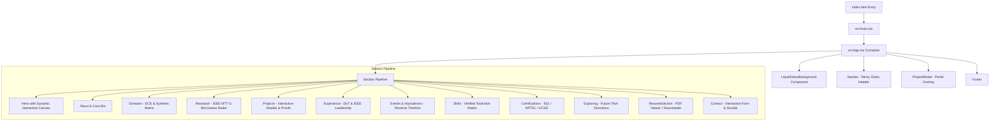

# 🧭 Soham Khan — Portfolio Architecture & System Design

This document details the architectural principles, component structure, rendering pipelines, and design token implementation powering the **Soham Khan Engineering Portfolio**.

---

## 📑 Table of Contents
- [1. Architectural Overview](#1-architectural-overview)
- [2. Component Tree & Data Flow](#2-component-tree--data-flow)
- [3. Liquid Glass UI Engine](#3-liquid-glass-ui-engine)
- [4. Performance & Optimization Strategy](#4-performance--optimization-strategy)
- [5. TypeScript Type System](#5-typescript-type-system)
- [6. Build & Compilation Pipeline](#6-build--compilation-pipeline)

---

## 1. Architectural Overview

The portfolio is architected as a high-performance single-page application (SPA) built on **React 19**, **TypeScript 5.8**, **Vite 6**, and **Tailwind CSS v4**.



---

## 2. Component Tree & Data Flow

All persistent portfolio records are cleanly separated into `src/data/resumeData.ts` and strongly typed in `src/types.ts`.

### Component Directory Matrix

| Component | Purpose | Key Integrations |
| :--- | :--- | :--- |
| `Navbar.tsx` | Sticky frosted glass header with section tracking | Smooth scroll navigation, active section indicators |
| `Hero.tsx` | Recruiter-friendly introduction & quick action CTAs | PDF download, primary social badges, direct links |
| `HeroCanvas.tsx` | Interactive HTML5 Canvas particle & circuit node mesh | Mouse repulsion, high-DPI scaling, smooth animation loop |
| `LiquidGlassBackground.tsx` | Multi-layered ambient fluid orbs with ECE RF scan overlay | CSS keyframes, SVG filters, reduced-motion fallback |
| `Research.tsx` | IEEE MTT-S 2.45 GHz radar & non-contact vital tracking | Interactive pipeline breakdown, signal processing specs |
| `Projects.tsx` | Hardware, embedded systems & AI project grid | Category filtering, modal detail launcher |
| `ProjectModal.tsx` | Deep-dive modal with problem/solution/outcomes | Keyboard accessibility (`Esc`), background scroll locking |
| `Experience.tsx` | Verifiable positions with LinkedIn direct links | Reverse chronological hierarchy, current badges |
| `EventsSection.tsx` | Reverse-chronological timeline of hackathons & events | Winner badges, official organization links |
| `Certifications.tsx` | Verifiable credential matrix (IISc, NPTEL, Coursera) | Direct verification CTAs, national excellence badges |
| `Contact.tsx` | Direct outreach channel with copyable email & forms | Feedback state, input validation |

---

## 3. Liquid Glass UI Engine

The design language marries **Apple iOS liquid glass** aesthetics with **Electronics & Communication Engineering** precision:

```css
/* Glass Card Utility System */
.glass-card {
  background: radial-gradient(
    135% 125% at 0% 0%,
    rgba(255, 255, 255, 0.9) 0%,
    rgba(255, 255, 255, 0.65) 60%,
    rgba(240, 246, 255, 0.5) 100%
  );
  backdrop-filter: blur(20px) saturate(180%);
  -webkit-backdrop-filter: blur(20px) saturate(180%);
  border: 1px solid rgba(255, 255, 255, 0.85);
  box-shadow: 
    0 8px 32px 0 rgba(31, 38, 135, 0.05),
    inset 0 1px 0 0 rgba(255, 255, 255, 0.95);
}
```

### Motion and Physics
- **Floating Orbs**: Three non-linear floating ambient gradients with 18s–26s cycle durations.
- **RF Radar Scan**: Subtle 0.03 opacity sweeping radar grid simulating microwave measurement instruments.
- **Accessible Motion**: All continuous animations auto-pause when `prefers-reduced-motion: reduce` is detected.

---

## 4. Performance & Optimization Strategy

1. **Zero Runtime CSS Overhead**: Styled entirely using Tailwind CSS v4's modern engine.
2. **Dynamic Canvas Throttling**: The interactive background canvas dynamically reduces particle density on mobile screens and pauses updates when off-screen.
3. **No Heavy External 3D Runtimes**: Pure canvas 2D and hardware-accelerated CSS transforms ensure 60 FPS rendering on budget mobile devices.
4. **Optimized Asset Pipeline**: SVG vector iconography via `lucide-react` with treeshaking.

---

## 5. TypeScript Type System

Central types in `src/types.ts`:

```typescript
export interface Project {
  id: string;
  title: string;
  category: string;
  period: string;
  summary: string;
  highlights: string[];
  techStack: string[];
  githubUrl?: string;
  liveUrl?: string;
  demoUrl?: string;
  pipeline?: { title: string; desc: string }[];
}

export interface WorkExperience {
  role: string;
  organization: string;
  period: string;
  highlights: string[];
  keywords: string[];
  employmentType?: string;
  location?: string;
  workMode?: string;
  isCurrent?: boolean;
  linkedInUrl?: string;
}
```

---

## 6. Build & Compilation Pipeline

The codebase compiles with `vite build`:
- **TypeScript**: Strict type-checking with zero implicit any (`tsc --noEmit`).
- **Asset Bundling**: Minified JavaScript and CSS outputs into `/dist`.
