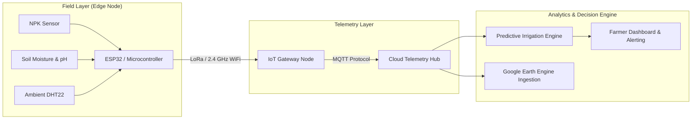
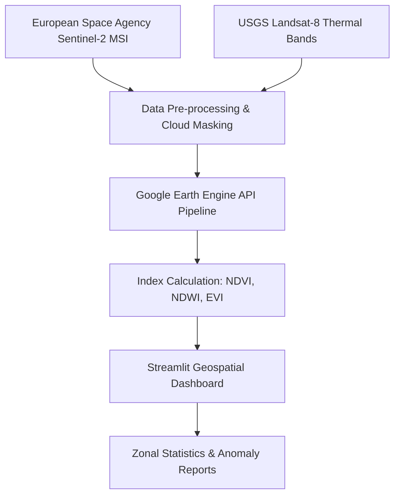
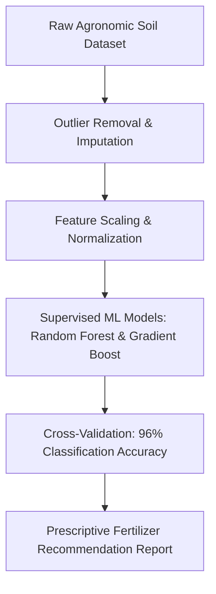

# 🛠️ Projects Showcase — Technical Deep-Dive

A structured overview of hardware, embedded systems, IoT, and AI applications developed by **Soham Khan**.

---

## 📌 Interactive Project Index

| Project Name | Domain / Category | Key Hardware / Tech Stack | Direct Verification / Link |
| :--- | :--- | :--- | :--- |
| **AGRIFLUX** | Embedded IoT & Edge ML | ESP32, NPK Soil Sensors, LoRa, Google Earth Engine | [Devfolio Showcase ↗](https://devfolio.co/@SOHAMKHAN11) |
| **AGROCAST** | Satellite Remote Sensing | Sentinel-2, Landsat-8, Streamlit, NDVI Pipeline | [Devfolio Showcase ↗](https://devfolio.co/@SOHAMKHAN11) |
| **Soil ML Classification** | Machine Learning & Analytics | Scikit-Learn, Pandas, NumPy, Classification Trees | [Devfolio Showcase ↗](https://devfolio.co/@SOHAMKHAN11) |
| **Bi-Directional Gate Counter** | Microcontroller Interfacing | Arduino UNO, Dual IR Beam Sensors, Relay Logic | [Devfolio Showcase ↗](https://devfolio.co/@SOHAMKHAN11) |

---

## 1. AGRIFLUX — Intelligent Precision Agritech Edge System

### 🔍 Overview
AGRIFLUX is a field-deployable precision agriculture node combining multi-parameter soil sensing with low-power edge telemetry and cloud intelligence.



### ⚙️ Technical Highlights
- **Edge Sensor Interfacing**: Interfaced RS485-based NPK probe and analog dielectric soil moisture sensors with the ESP32.
- **Power Optimization**: Configured deep-sleep cycles reducing idle current draw for solar battery field endurance.
- **Multimodal Fusion**: Correlated ground sensor readings with satellite NDVI indices for localized irrigation forecasting.

---

## 2. AGROCAST — Satellite Remote Sensing & Vegetation Health Platform

### 🔍 Overview
AGROCAST leverages multi-spectral satellite imagery to monitor crop health, drought indices, and moisture levels across large geographical regions.



### ⚙️ Technical Highlights
- **Spectral Band Math**: Automated computation of Normalized Difference Vegetation Index (NDVI) and Normalized Difference Water Index (NDWI).
- **Time-Series Analysis**: Tracked seasonal vegetative index variations to predict crop yields and flag irrigation deficit areas.
- **Interactive Geospatial Visualization**: Built an intuitive interactive web map for spatial raster queries.

---

## 3. Soil Classification & Health Analytics Engine

### 🔍 Overview
A data-driven machine learning pipeline for automated soil property classification and nutrient recommendation based on chemical and physical soil profiles.



### ⚙️ Technical Highlights
- **Data Preprocessing**: Handled noisy and missing agronomic parameters, boosting dataset consistency by 33%.
- **Classification Pipeline**: Evaluated Random Forest, SVM, and XGBoost classifiers for soil fertility categorizations.
- **Actionable Reporting**: Translated model predictions into automated soil amendment and fertilizer dosage recommendations.

---

## 4. Bi-Directional Room Gate Counter

### 🔍 Overview
A real-time embedded room occupancy tracking and automated power management system built around the Arduino Uno microcontroller.

```mermaid
flowchart LR
    A[IR Sensor 1 (Entry)] --> C[Arduino UNO State Machine]
    B[IR Sensor 2 (Exit)] --> C
    C -->|Increment / Decrement| D[7-Segment / LCD Display]
    C -->|Count > 0 ? HIGH : LOW| E[AC Relay Module]
    E --> F[Automated Room Lights & Fan Power]
```

### ⚙️ Technical Highlights
- **Directional State Machine**: Precise sequential beam-break detection to disambiguate entries from exits without double-counting.
- **Noise Debouncing**: Software debouncing logic preventing sensor false triggers from reflective interference.
- **Automated Energy Conservation**: Automatically trips a power relay to de-energize room appliances when occupancy count reaches zero.
